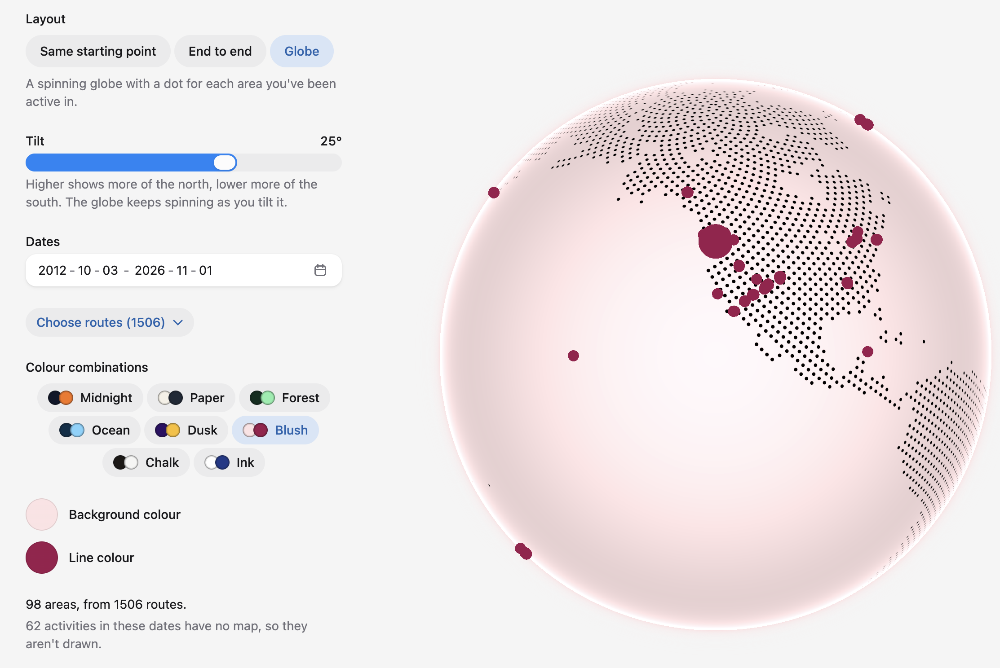
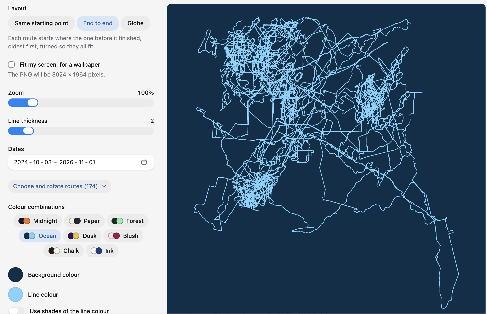

# Route Art

Turn the routes from your Strava activities into a picture you can download.

**Try it:** https://route-art.micheleromano.workers.dev. Use the sample routes without signing in, or connect your own Strava account.





## What you can make

- **Layouts**
  - **Same starting point:** every route starts in the middle and spreads out from there.
  - **End to end:** each route starts where the one before it finished, oldest first, turned so they all fit.
  - **Globe:** a globe with a dot for each area you've been active in. You can tilt it north or south, and spin it at the speed you choose.
- **Choose your routes**
  - Pick a date range.
  - Untick individual routes to leave them out.
  - Rotate any route on its own.
- **Colours:** eight ready-made colour combinations, each checked for contrast. You can also pick your own colours, or use shades of one colour from newest to oldest.
- **Downloads**
  - SVG or PNG.
  - "Fit my screen" makes a picture the shape and size of your screen, for a wallpaper.
  - On the Globe, the PNG can have a transparent background, for putting on a website.
  - On phones, "Share or save picture" sends it to the share menu.

## Privacy

The app keeps as little as it can, and says what it keeps.

- **Your Strava activities:** only each activity's date and route line are kept, and only in your browser. They pass through the app's server on the way, but aren't stored there.
- **Signing in:** a sign-in cookie keeps you connected until you close your browser. **Disconnect** withdraws the app's access on Strava and removes your activities from the browser.
- **What pictures can show:**
  - By default, the first and last 500 metres of each route are hidden, since a route's start is often someone's home.
  - The Globe rounds places to about 25 km, using the middle of each route, never its start.
  - Downloads only contain what's visible in the picture.
- **The sample routes** are some of the creator's public activities:
  - only the day of each one is kept, not the time;
  - each route is stored as a shape, with no real coordinates;
  - the only position kept is a rounded area for the Globe.

## How it's built

- **App:** [React Router](https://reactrouter.com) (framework mode) on [Cloudflare Workers](https://workers.cloudflare.com).
- **Interface:** [HeroUI](https://heroui.com) and Tailwind CSS, with light and dark mode.
- **Globe:** drawn with [cobe](https://github.com/shuding/cobe).
- **Strava:** sign-in uses OAuth. Strava tokens stay in an httpOnly cookie and never reach the page's JavaScript.
- **Accessibility:** aims for WCAG 2.2 AA, with plain-language copy.
- **Translations:** every piece of text is in `app/locales/en.json`, ready to be translated.

## Running it locally

You need Node.js and pnpm. Corepack, which comes with Node, can set up the right pnpm version.

1. Install:
   ```sh
   corepack enable pnpm
   pnpm install
   ```
2. Create a Strava app at https://www.strava.com/settings/api, with `localhost` as the Authorization Callback Domain.
3. Copy `.dev.vars.example` to `.dev.vars`. Add the app's Client ID and Client Secret, and a session secret from `openssl rand -base64 32`. `.dev.vars` is gitignored, so never commit it.
4. Start the app at http://localhost:5173:
   ```sh
   pnpm dev
   ```

The sample routes come from `app/data/demo-activities.json`. It's gitignored, and the app's owner creates it with `pnpm demo:fetch`. Without it, the app simply doesn't offer sample routes.

## Commands

| Purpose          | Command           |
| ---------------- | ----------------- |
| Dev server       | `pnpm dev`        |
| Unit tests       | `pnpm test`       |
| End-to-end tests | `pnpm test:e2e`   |
| Lint             | `pnpm lint`       |
| Type check       | `pnpm typecheck`  |
| Format           | `pnpm format`     |
| Sample routes    | `pnpm demo:fetch` |
| Deploy           | `pnpm run deploy` |

- **End-to-end tests** run against a production build, with a stand-in for Strava, so they need no secrets.
- **GitHub Actions** runs the type check, lint and every test on each pull request, and `main` only accepts changes through pull requests that pass.

## Strava

Route Art isn't made or endorsed by Strava. It uses the Strava API under Strava's [API Agreement](https://www.strava.com/legal/api) and [brand guidelines](https://developers.strava.com/guidelines/).
